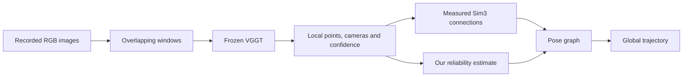

# Understanding the project before understanding the code

Read this in small pieces. You do not need all the equations on the first pass. The first objective is to explain the problem in your own words.

## 1. What part of robotics is this?

Imagine a robot with a camera driving down a road. It sees a sequence of images. To navigate, it needs an estimate of where it is and a representation of what surrounds it.

**Localization** estimates the camera or robot's position and orientation. **Mapping** reconstructs the environment. **SLAM**, simultaneous localization and mapping, estimates both as the robot moves through an initially unknown environment. A **trajectory** is the sequence of estimated camera poses. A **pose** contains position and orientation; it does not normally contain scale.

Our project belongs to visual geometry and visual SLAM, particularly long-sequence reconstruction using pretrained geometric models. We are evaluating camera trajectories from recorded data. We are not building a robot controller or claiming online autonomous navigation.

A wrong trajectory matters even if a reconstruction initially looks impressive: a straight road may bend, revisiting the same building may create two buildings in the map, or a supposed loop closure may fold distant streets onto each other.

## 2. What information does an image provide?

A normal photograph tells us which direction a visible object lies in, but not its exact distance. A nearby small object and a distant large object can occupy the same pixels.

For a pinhole camera, a 3D point in camera coordinates `(X,Y,Z)` projects approximately to

`u = fx X/Z + cx`, `v = fy Y/Z + cy`.

The numbers `fx, fy, cx, cy` describe the camera's internal geometry, called **intrinsics**. A camera pose describes its location and orientation relative to a chosen coordinate system, often called **extrinsics**. Be careful: software may store either world-to-camera or camera-to-world extrinsics.

If we double every distance, both numerator and denominator double, and the image coordinates stay the same. This is the basic monocular scale ambiguity. A learned model can use familiar object sizes to guess scale, but an RGB image alone does not geometrically guarantee metres. Known stereo baselines, depth measurements, or suitable other sensors can provide metric scale.

Multiple images of a scene constrain geometry through shared observations. Moving the camera creates **parallax**, the apparent displacement of nearby objects relative to distant ones. Little parallax, few shared objects, or moving objects can make reconstruction unreliable.

## 3. What is VGGT?

VGGT is an already-trained neural network. It jointly processes images and predicts camera parameters and scene geometry. Its outputs include depth and point maps, with associated confidence outputs; the project does not require us to train VGGT. A **depth map** assigns a depth to each pixel. A **point map** assigns a 3D position to each pixel. The points and cameras use a reconstruction coordinate system. [VGGT paper](https://arxiv.org/abs/2503.11651)

A transformer lets image features exchange information through attention. You can initially understand this as the model comparing evidence across images to infer a shared scene. Knowing how attention matrices are implemented is not a prerequisite for our first experiment.

**Feed-forward** means this prediction is obtained by running the trained network. It does not mean the whole SLAM system has no optimization, or that the model was never trained.

**Frozen** means the network weights stay fixed in our project. We can still fit a small statistical mapping from its outputs to observed errors. That is learning a calibration, even though we are not retraining the large network.

## 4. Why divide the video into windows?

Thousands of images are expensive to process jointly. We instead take windows, for example frames 0–15, then 8–23, then 16–31. These windows share eight images each. Window size and overlap are separate choices.

Each forward pass gives a local reconstruction. Unfortunately, its coordinates, orientation, and scale need not match the next reconstruction. Think of teammates independently drawing overlapping pieces of a map on different sheets of paper, using different rulers.

The shared frames provide point correspondences: the same pixel of the same input frame has a 3D prediction in both reconstructions. We find a transform that best brings those two sets of points together. This is the chunk-and-align idea used by VGGT-Long. [VGGT-Long paper, Sections 3.1–3.3](https://arxiv.org/html/2507.16443v1)

A **rigid transform**, SE(3), rotates and translates. It has six degrees of freedom: three for rotation and three for translation. A **similarity transform**, Sim(3), also changes uniform scale, giving seven degrees of freedom:

`p_in_first_window = scale * rotation * p_in_second_window + translation`.

Our `fit_similarity` function estimates this transform from matching 3D points. **Umeyama alignment** is a least-squares solution to that fitting problem. It needs geometry that determines the transform; completely stationary or collinear points do not determine all its parameters.

## 5. What is drift, and why do loops help?

Suppose every connection introduces a small error. Composing hundreds of connections accumulates position, orientation and scale errors. This is **drift**. It is not necessarily caused only by the boundaries: errors within each reconstruction and imperfect camera calibration also contribute.

A **loop closure** adds evidence that two distant times observed the same place. **Place recognition** suggests a candidate from image appearance. **Geometric verification** checks whether the images can be made geometrically consistent. An appearance match alone is insufficient: two different intersections can look similar.

Represent each reconstruction window as a node in a graph and each measured relationship as an edge. A **pose graph** adjusts the node transforms to make the edges agree as well as possible.

The graph cannot simply satisfy everything when measurements conflict. It must compromise. Our question is how it should choose that compromise.

## 6. What does it mean to trust an edge?

Suppose two measurements disagree. One came from a clear building viewed from many useful angles; another came from a blurred, almost textureless scene. Giving them equal influence may waste good evidence.

An **error** is the difference from truth in a particular case. **Uncertainty** describes the expected spread of errors across comparable cases before knowing that particular answer. **Confidence** is the model's native score. These three quantities are related, but are not interchangeable.

An uncertainty of 0.1 metres and one of 10 metres should lead to different influence. In a simple Gaussian model, the weight is inverse variance: `weight = 1 / sigma²`. In multiple dimensions, covariance becomes a matrix, and its inverse is the **information matrix**. A 7-dimensional Sim(3) residual needs a 7-by-7 information matrix in the same coordinate convention.

The simplest graph objective is

`sum over edges: residual.T @ information @ residual`.

The residual measures disagreement between an edge's measured transform and the transform implied by its two nodes. A good fit makes trusted disagreements costly. A **robust kernel** reduces the influence of very large disagreements; it helps with outliers but does not magically identify every false loop.

The key idea: **pixel confidence says something about individual predicted geometry; the graph needs uncertainty about an entire estimated transform.** Ten thousand pixels do not provide ten thousand independent votes if they share the same reconstruction error. Nearby edges can also share errors because their windows overlap.

## 7. Ranking and calibration answer different questions

A weather forecaster can consistently identify the rainier day yet call a 30% event 90%. The ordering is useful; the magnitude is wrong.

Likewise, a model can correctly rank its good and bad pixels while understating their actual errors. **Calibration** asks whether the claimed uncertainty matches measured errors on unseen examples. A native VGGT confidence score is not a probability and should not be read as a percentage. Existing research already studies pixel-confidence calibration, so repeating it alone would not establish our contribution. [Calibration audit](https://arxiv.org/abs/2608.29705)

Our initial calibrator learns a monotone curve: as confidence increases, the predicted error variance cannot increase. This is **isotonic regression**. It uses labelled fitting examples; it is not a new neural network and it is not label-free. It cannot create information that the input score never contained.

For example, high pixel confidence may coexist with poorly determined camera motion when views have little overlap or parallax. Pose-reliability work such as GeoCond already investigates this issue, including graph weighting. Our more specific possible extension is uncertainty of long-sequence chunk alignments, with scale and correlation explicitly examined. That extension still needs evidence and a careful related-work comparison. [GeoCond](https://arxiv.org/abs/2609.18465)

## 8. What counts as evidence, and what counts as proof?

We can mathematically prove a limited claim under stated assumptions. For example, a chain of freely adjustable nodes can exactly satisfy every edge: start at node 0 and compose each measured transform. Every residual is zero, regardless of positive edge weights. Therefore weighting alone cannot repair a chain. A cycle, an additional measurement, or another prior is needed to create a conflict.

We cannot prove from this that our real system will improve. For that, we need empirical evidence: fit on some sequences, freeze the method, and compare methods on other sequences using identical inputs and graph structure. A pretty point cloud or one improved sequence is insufficient.

An **ablation** changes one ingredient to see what caused an effect. If calibrated weights help, we should compare them against raw confidence, constant weights with sensible rotation/translation/scale balance, and geometry-only reliability. Otherwise the supposed contribution could just be unit balancing or a better outlier threshold.

**ATE**, absolute trajectory error, compares estimated camera positions to reference positions. For an arbitrary-scale monocular reconstruction we can align the complete estimated trajectory to the reference using one global Sim(3). We must not align each window independently for the final trajectory score; that would hide the very drift being studied.

Our local ATE code is a preflight tool. The final protocol will be checked against evo, and the official KITTI relative segment errors are a separate evaluation. [evo metrics](https://github.com/MichaelGrupp/evo/wiki/Metrics), [KITTI evaluation](https://www.cvlibs.net/datasets/kitti/eval_odometry.php)

For the first session, stop here and open `week1_workbook.md`. You should be able to explain the camera problem, the need for window alignment, and why a loop lets weights influence the answer. The rest can be learned while we implement and examine measurements.
